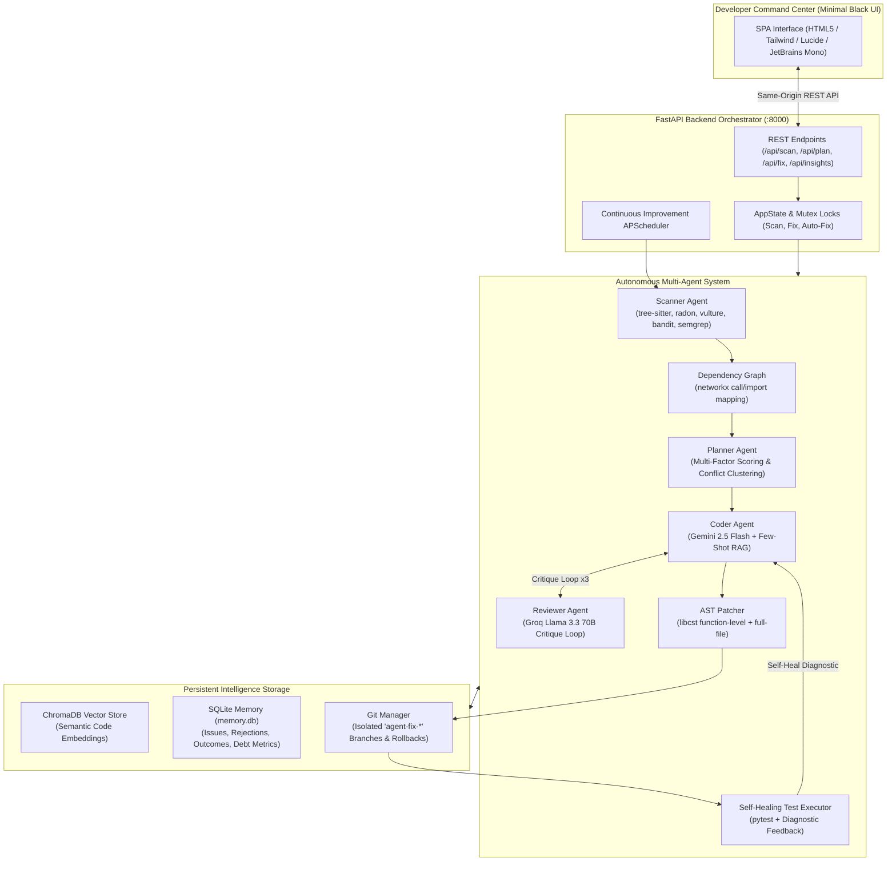

# 🧬 Codebase Self-Evolving Agent

**An Autonomous Multi-Agent AI System for Continuous Codebase Evolution & Technical Debt Remediation**

> **Academic Year 2025–2026** · Master of Computer Applications (MCA) Project  
> Production-Hardened Architecture & Minimal Black Developer Command Center

[](#technology-stack)
[](#technology-stack)
[](#architecture)
[](#license)

---

## 📌 Project Overview

Most developer tooling is **reactive**—it remains dormant until explicitly triggered. The **Codebase Self-Evolving Agent** is a **proactive, continuous code intelligence engine**. It autonomously scans multi-language repositories, performs graph-aware dependency impact analysis, calculates multi-factor priority scores, formulates AST-level fixes through dual-LLM critique loops, verifies fixes with automated tests, and learns from developer acceptance and rejection patterns without silently mutating code without approval.

The system features a **production-grade, minimal black command center** providing real-time telemetry, interactive fix review diffs, dependency visualization, semantic RAG search, and continuous technical debt metrics.

---

## 🏗️ Architecture



---

## 🚀 Key Implemented Capabilities

### 1. Multi-Language Static & Security Scanning (9 Languages)
- **Languages supported**: Python, JavaScript, TypeScript, Go, Rust, Java, C, C++, PHP.
- **Deep Code Quality Checks**: Cyclomatic complexity (Radon), dead code (Vulture), deep nesting (>4 levels), long functions (>60 lines), duplicate code clone detection.
- **AppSec Scanning**: Hardcoded secrets/API keys detection, SQL injection heuristics, weak cryptographic hashes (MD5/SHA1), Bandit AST inspection, Semgrep security rules, and npm audit / safety dependency scanning.

### 2. Incremental Codebase Intelligence & Stale Invalidation
- Computes SHA-256 manifests across source files and tracks Git commit revisions.
- Intelligently detects added, modified, renamed, and deleted files.
- Automatically re-analyzes only changed files plus dependent modules via `DependencyGraph`.
- Reuses verified cached scan findings, achieving up to 90%+ scan acceleration on large repositories.
- Persists scan metadata and cache hit rates in `data/last_scan_meta.json`.

### 3. Multi-Factor Issue Prioritization & Conflict Avoidance
- Prioritizes issues using:
  $$\text{Priority} = \text{Severity} + \text{Complexity} + \text{Dependency Impact} + \text{Test Presence} + \text{Quick-Win Bonus} - \text{Rejection Penalty}$$
- Provides transparent mathematical explanations for every ranking.
- Clusters adjacent issues in the same file within 10 lines, assigning shared `group_id`s and tracking `conflicts_with` references to prevent colliding concurrent edits.

### 4. Dual-LLM Adversarial Fix Synthesis & AST Patching
- **Coder Agent** (Google Gemini 2.5 Flash) generates surgical patches using localized RAG context and semantic embeddings.
- **Reviewer Agent** (Groq Llama 3.3 70B) independently audits the patch for side effects and style consistency in an iterative critique loop (up to 3 turns).
- **AST Patcher**: Uses `libcst` for surgical function-level modifications in Python without corrupting file structure.

### 5. Categorized Self-Healing Correction Loop
- Categorizes validation failures into **Syntax**, **Tests**, **Environment**, or **Infrastructure**.
- Feeds structured diagnostic tracebacks back into the Coder for minimal corrective revisions.
- Strictly bounded by configurable retry limits; automatically reverts the branch on non-convergence.

### 6. Git Safety & Developer Approval Gate
- Every fix executes on an isolated Git branch (`agent-fix-<id>`).
- Working-tree cleanliness check protects uncommitted user work.
- Permanent merges occur **only** after human review in the Fix Review Studio.
- Instant single-click rollback for any previously applied fix.

### 7. Developer Decision Learning & Persistent Debt Analytics
- Tracks `accepted`, `rejected`, `false_positive`, and `rollback` actions in SQLite.
- Rejection memory automatically adjusts future prioritization and prevents re-suggesting declined patterns.
- Real-time dashboard metrics calculate open debt, remediation hours, hotspot files, and recurring patterns.

---

## 💻 Technology Stack

| Layer | Technologies |
|---|---|
| **Backend & API** | Python 3.11+, FastAPI, Uvicorn, Pydantic, APScheduler |
| **Frontend** | HTML5, TailwindCSS, Lucide Icons, Chart.js, JetBrains Mono (Minimal Black Theme) |
| **AI & LLM Orchestration** | Google GenAI SDK (Gemini 2.5 Flash), Groq SDK (Llama 3.3 70B Versatile) |
| **Semantic Code Search** | ChromaDB, Sentence-Transformers, HuggingFace Embeddings |
| **AST & Code Analysis** | LibCST, Tree-Sitter, Radon, Vulture, PyFlakes, Bandit, Semgrep |
| **VCS & Graph Engine** | GitPython, NetworkX |
| **Database & Persistence** | SQLite3 (thread-safe connection pooling) |

---

## 📁 Repository Structure

```
CodeBaseAgent/
├── agents/                  # Autonomous Agent Implementations
│   ├── scanner.py           # Multi-language static & incremental security analysis
│   ├── planner.py           # Multi-factor issue prioritization & clustering
│   ├── coder.py             # LLM code generation with RAG context
│   ├── reviewer.py          # Adversarial review & critique loop
│   ├── test_writer.py       # Automated unit test generation
│   ├── doc_writer.py        # Docstring synthesizer
│   └── runtime_tester.py    # Runtime web server error scanner
├── core/                    # Core Infrastructure & Tooling
│   ├── git_manager.py       # Isolated branches, snapshots, merges, rollbacks
│   ├── graph.py             # Dependency graph & impact radius (NetworkX)
│   ├── patcher.py           # AST function-level patching (LibCST)
│   ├── executor.py          # Test execution & self-healing feedback
│   ├── security_scanner.py  # Bandit, Semgrep, and dependency audit
│   ├── duplicate_detector.py# Code clone detection
│   ├── syntax_checker.py    # Syntax error & AST verification
│   └── rename_propagator.py # Cross-repository symbol refactoring
├── memory/                  # Persistence & Embeddings
│   ├── sqlite.py            # Relational memory (scans, debt, rejections, decisions)
│   └── chroma.py            # Vector database for semantic RAG retrieval
├── scheduler/               # Automated Continuous Improvement
│   └── jobs.py              # Mutex-protected background scanning schedules
├── ui/                      # Minimal Black Developer Command Center
│   ├── server.py            # FastAPI production application server
│   ├── app.py               # Legacy Streamlit alternative
│   └── static/
│       └── index.html       # Single-page developer interface
├── tests/                   # Test Suite (API, E2E, Graph, Patcher, Evolution)
├── config.py                # Global configuration & environment validation
├── Dockerfile               # Production container definition
├── Procfile                 # Cloud PaaS deployment descriptor (Render/Railway)
├── requirements.txt         # Production dependencies
└── .env.example             # Safe environment variable template
```

---

## 🛠️ Local Installation & Setup

### 1. Prerequisites
- Python 3.11 or 3.12 installed
- Git installed and configured on your PATH
- Free API keys from:
  - [Google AI Studio](https://aistudio.google.com) (for Gemini 2.5 Flash)
  - [Groq Console](https://console.groq.com) (for Llama 3.3 70B)
  *(Note: The agent can run in offline static analysis mode even if API keys are omitted.)*

### 2. Clone and Setup Environment

```bash
# Clone the repository
git clone https://github.com/your-username/CodebaseSelfEvolvingAgent.git
cd CodebaseSelfEvolvingAgent

# Create and activate virtual environment
python -m venv venv
# On Windows:
venv\Scripts\activate
# On Linux/macOS:
source venv/bin/activate

# Install dependencies
pip install -r requirements.txt
```

### 3. Configure Environment Variables

Copy `.env.example` to `.env`:

```bash
cp .env.example .env
```

Edit `.env` and insert your credentials:

```ini
GEMINI_API_KEY=your_actual_gemini_api_key_here
GROQ_API_KEY=your_actual_groq_api_key_here
PORT=8000
HOST=0.0.0.0
DEMO_MODE=false
```

---

## 🖥️ Running the Application

### 1. Launch the Command Center (Recommended)

Start the production FastAPI server:

```bash
python -m uvicorn ui.server:app --host 0.0.0.0 --port 8000 --reload
```

Open your browser to: **[http://localhost:8000](http://localhost:8000)**

### 2. First-Run Guide (Connecting a Repository)

1. When the Command Center loads, the top bar displays `No repository connected`.
2. In the left sidebar:
   - Click **Browse** or paste the absolute path to any local Git repository (or use `.` to inspect the agent repository itself).
   - Click **Connect Repository**.
3. Once connected:
   - Click **Incremental Scan** for rapid re-analysis of modified files, or **Full Scan** for a complete baseline.
   - Click **Generate Plan** to review prioritized findings with transparent scores and test-coverage indicators.
   - Click **Send to Fix Studio** on any issue to generate an isolated AST patch, review the visual diff, and safely merge or reject.

### 3. Command Line Interface (CLI)

The agent can also be executed directly via the terminal:

```bash
# Incremental scan on target repository
python main.py /path/to/repo --scan

# Full comprehensive scan
python main.py /path/to/repo --scan --full

# Generate fix plan with priority scoring
python main.py /path/to/repo --scan --plan

# View historical statistics
python main.py /path/to/repo --stats
```

---

## 🌐 Cloud Deployment Guide

The application is structured for instant containerized deployment on platforms like **Render**, **Railway**, **Fly.io**, or **Hugging Face Spaces**.

### Option A: Render / Railway (Procfile or Dockerfile)
1. Push your repository to GitHub.
2. Create a **New Web Service** on Render or Railway connected to your GitHub repository.
3. Configure settings:
   - **Environment**: Docker (or Python using `Procfile`)
   - **Build Command**: `pip install -r requirements.txt`
   - **Start Command**: `uvicorn ui.server:app --host 0.0.0.0 --port $PORT`
4. In **Environment Variables**, configure:
   - `GEMINI_API_KEY`: Your Google GenAI API key.
   - `GROQ_API_KEY`: Your Groq API key.
   - `DEMO_MODE`: Set to `true` for public deployments.

### Option B: Local or Server Docker Container

```bash
# Build the production image
docker build -t codebase-agent .

# Run the container
docker run -d -p 8000:8000 \
  -e GEMINI_API_KEY="your_api_key" \
  -e GROQ_API_KEY="your_api_key" \
  -e DEMO_MODE="true" \
  --name codebase-agent codebase-agent
```

Access the interface at `http://localhost:8000`.

---

## 🔒 Security & Public Demo Sandbox

When deployed as a public demonstration, security guardrails must prevent anonymous visitors from accessing the host filesystem or modifying repositories destructively.

Setting `DEMO_MODE=true` automatically activates:
- **Filesystem Boundary Sandboxing**: Path traversal outside the application's root directory is strictly rejected with HTTP 403.
- **Git Merge Protection**: Merging patches into the primary branch via `/api/fix/apply` is disabled, protecting repository integrity while keeping patch generation, AST diffing, test writing, and review studio fully interactive.
- **Disabled Host Folder Picker**: Native GUI folder pickers (which crash in headless cloud environments) are safely disabled.
- **Zero Raw Terminal Execution**: No unauthenticated shell or terminal execution endpoints are exposed.

---

## ⚠️ Known Limitations

- **Syntactic & Structural Fixes**: Excels at fixing complexity, nesting, dead code, duplicate blocks, missing documentation, type hints, hardcoded secrets, and standard security vulnerabilities.
- **Complex Domain Business Logic**: Cannot infer implicit business rules or domain requirements that are not documented or covered by existing specifications.
- **Ephemeral Cloud Filesystems**: On free-tier cloud platforms without attached persistent volumes, SQLite history and ChromaDB vectors reset upon container restart.

---

## 📄 License

This project is licensed under the **MIT License** — see the [LICENSE](LICENSE) file for details.
